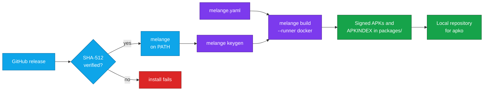
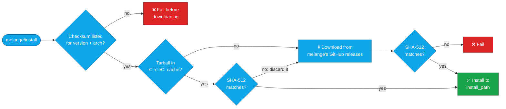

<div align="center">


# Melange Orb for CircleCI

### Build signed APK packages for your distroless images, right inside your CircleCI pipeline.

Install [melange](https://github.com/chainguard-dev/melange) with one step of CircleCI config, then build APKs from declarative YAML pipelines<br>
and hand them to [apko](https://github.com/chainguard-dev/apko) to assemble minimal, distroless container images.<br>
Strict SHA-512 verification by default · No `sudo` · No usage data collected by the orb

[](https://circleci.com/gh/juburr/melange-orb)
[](https://circleci.com/developer/orbs/orb/juburr/melange-orb)
[](LICENSE)
[](https://discuss.circleci.com/c/ecosystem/orbs)


**[Quick Start](#-quick-start)** · **[Features](#-why-melange-orb)** · **[Building Packages](#-building-packages)** · **[Commands](#-commands)** · **[Checksums](#-checksum-verification)** · **[Security](#-secure-by-design)**

<sub>An unofficial, community-maintained orb. [Contributions are welcome!](#-contributing)</sub>

</div>

<br>

## ✨ Why melange-orb?

<table>
<tr>
<td width="33%" valign="top">
🔐 <b>Verified, fail-closed installs</b><br><br>
Every melange binary comes straight from melange's official GitHub releases and is checked against a SHA-512 checksum pinned in this orb. By default, a version without a known checksum fails before anything is downloaded.
</td>
<td width="33%" valign="top">
🐙 <b>Made for apko</b><br><br>
<code>melange build</code> writes signed APKs and a signed <code>APKINDEX.tar.gz</code> that apko can use as a local repository. The <a href="https://github.com/juburr/apko-orb">apko orb</a> takes it from there.
</td>
<td width="33%" valign="top">
🧪 <b>Tested end to end</b><br><br>
Every change builds and verifies a signed APK on amd64 and arm64, with both the <code>docker</code> and <code>bubblewrap</code> runners. See <a href="#choosing-a-runner">Choosing a Runner</a>.
</td>
</tr>
<tr>
<td width="33%" valign="top">
🦾 <b>amd64 and arm64</b><br><br>
The matching Linux build is picked automatically, including on CircleCI's <code>arm.medium</code> machines, and cached per version and architecture so repeat jobs skip the download. Cached copies are verified too.
</td>
<td width="33%" valign="top">
📌 <b>200+ releases covered</b><br><br>
Checksums for melange releases from <code>0.1.0</code> up to the orb's pinned default, on both architectures. Pick yours with <code>version</code>.
</td>
<td width="33%" valign="top">
🙅 <b>No sudo, no telemetry</b><br><br>
melange installs to a user-owned directory, and nothing in this orb runs as root. No usage data of any kind is collected or sent back to the orb developer.
</td>
</tr>
</table>

## 🔄 How It Works



`melange/install` downloads melange straight from its official GitHub releases, verifies its SHA-512 checksum in the default `strict` mode shown here, and puts it on `PATH`. See [Checksum Verification](#-checksum-verification) for the other modes. From there you run the `melange` CLI yourself: `melange keygen` creates a signing key pair, and `melange build` runs your package's pipeline in an isolated build environment and writes signed APKs and a signed `APKINDEX.tar.gz` to `packages/<arch>/`, ready for apko to install from.

## 🚀 Quick Start

Add the orb, call `melange/install`, then use the `melange` CLI directly in later steps. This orb only installs melange, so every `melange` flag is yours to use.

```yaml
version: 2.1

orbs:
  melange: juburr/melange-orb@0.2

jobs:
  build-apks:
    machine:
      image: ubuntu-2404:current
    resource_class: arm.medium # or medium for amd64
    steps:
      - checkout
      - melange/install
      - run:
          name: Generate Signing Key
          command: melange keygen # writes melange.rsa and melange.rsa.pub
      - run:
          name: Build APKs
          command: |
            melange build melange.yaml \
              --runner docker \
              --arch "$(uname -m)" \
              --signing-key melange.rsa \
              --source-dir dist \
              --out-dir packages

workflows:
  build:
    jobs:
      - build-apks
```

That's it. Swap in your own `melange.yaml` and the directory your package's sources or prebuilt files live in (`--source-dir`), and `packages/<arch>/` holds your signed APKs and a signed `APKINDEX.tar.gz`, ready for apko. See [Building Packages](#-building-packages) for what each flag does and how to pick a runner.

> [!TIP]
> Upgrading from 0.1.0? `install` now refuses melange versions it has no checksum for, and creates `install_path` and puts it on the `PATH` for you. See [Upgrading](#-upgrading).

> [!NOTE]
> Run `melange build` on a machine executor, as above. The `docker` runner needs a local Docker daemon, and `setup_remote_docker` runs the daemon on a separate host that can't mount the job's files.

## 🏭 Building Packages

The [Quick Start](#-quick-start) job is the same flow this orb's own CI runs on every change, on amd64 and arm64 machine executors (see `build-smoke-test` in [`.circleci/test-deploy.yml`](.circleci/test-deploy.yml)). It generates a signing key, then builds a package that copies a prebuilt binary into a signed APK for the machine's own architecture.

- `--arch "$(uname -m)"` builds only for the machine's own architecture. Without it, melange builds every architecture the package supports, and building for foreign architectures needs emulation.
- Packages are written to `packages/<arch>/` (`x86_64` or `aarch64`) along with an `APKINDEX.tar.gz` signed by `melange.rsa`. apko can then use the directory as a local repository, with `melange.rsa.pub` as the trusted key.
- A key generated per job is fine when apko consumes the packages in the same pipeline. Keep a persistent key if you publish the packages.

Next, assemble an image: the companion [apko orb](https://github.com/juburr/apko-orb) installs apko with the same checksum verification, and its [local signed repository guide](https://github.com/juburr/apko-orb#-installing-packages-from-a-local-signed-repository) shows how to list `packages` and `melange.rsa.pub` in the apko configuration.

### Choosing a Runner

`melange build` runs each package's pipeline in an isolated build environment created by a *runner*. Results on CircleCI's `ubuntu-2404:current` machine images (amd64 `medium` and arm64 `arm.medium`):

| Runner | Result | Setup |
| --- | --- | --- |
| `docker` (recommended) | ✅ Works on amd64 and arm64 | None. The `circleci` user can already use the machine's Docker daemon. No images are pulled; melange builds the build environment locally. |
| `bubblewrap` (melange's default on Linux) | ⚠️ Works on amd64 and arm64 after setup | Requires `sudo`: install `bubblewrap`, and allow it to create user namespaces. Without the second step it fails with `bwrap: setting up uid map: Permission denied`, because Ubuntu 24.04's AppArmor restricts unprivileged user namespaces (`kernel.apparmor_restrict_unprivileged_userns = 1`). See [`tests/smoke/setup_bubblewrap.sh`](tests/smoke/setup_bubblewrap.sh). |
| `qemu` | ❌ Not usable | Needs `/dev/kvm`, which machine executors don't provide. |

Pass `--runner` explicitly. If it is omitted on Linux, melange tries `bubblewrap` and fails unless the setup above has been done.

The Docker executor is not covered by these tests and isn't recommended for `melange build`. The `docker` runner needs a local Docker daemon: `setup_remote_docker` runs the daemon on a separate host that can't mount the job's files. The `bubblewrap` runner needs to create user namespaces inside the job's container.

## 🧰 Commands

### `melange/install`

Installs melange for Linux on amd64 or arm64, matching the executor's CPU. In the default `strict` mode it verifies the SHA-512 checksum first and refuses versions it has no checksum for; see [Checksum Verification](#-checksum-verification) for the opt-outs. Run it before any `melange` step. Needs bash 4 or newer on the executor.

| Parameter | Default | Description |
| --- | --- | --- |
| `version` | `0.61.2` | melange release to install; a leading `v` is ignored. Pin it so melange only changes when you decide to. Values that aren't a release version, such as `latest`, are rejected. |
| `install_path` | `$HOME/bin` | Absolute path of the directory to install the `melange` binary into, writable without root. Created if needed, and added to `PATH` for later steps when it isn't already on it. A leading `~/` is expanded. |
| `verify_checksums` | `strict` | `strict`, `known_versions` or `false`. See [Checksum Verification](#-checksum-verification). |
| `caching` | `true` | Cache the downloaded release tarball between jobs, keyed by melange version, CPU architecture and home directory. Only verified tarballs are cached, and they are verified again when restored. |

Environment variables are expanded in `version` and `install_path`.

## 📦 Upgrading

Upgrading from 0.1.0? No parameters were renamed, but `install` changed.

Behavior changes:
- `verify_checksums` defaults to `strict` instead of `known_versions`, so a melange version with no checksum in the orb's table fails the install. See [Checksum Verification](#-checksum-verification).
- `install_path` defaults to `$HOME/bin` instead of `/home/circleci/bin`, the same directory on CircleCI's images. It must be an absolute path without a `:`, and `install` creates it and adds it to the `PATH` of later steps when needed, so you no longer have to prepare it in an earlier step.
- `version` must be a release version, such as `0.61.2`. Anything else is rejected before anything is downloaded.
- `install` needs bash 4 or newer, and fails when the downloaded binary can't run on the executor.
- The cache key and location changed, so the first run after upgrading downloads melange again.

## 🔒 Secure by Design

- **Least Privilege**: Installs to a user-owned directory by default, with no `sudo` usage anywhere in this orb.
- **Integrity**: SHA-512 checksum validation of downloaded binaries, on by default and failing closed: a melange version this orb has no checksum for is refused, not installed unverified, and a binary that can't run on the executor never replaces an existing install. See [Checksum Verification](#-checksum-verification) for the `known_versions` and `false` opt-outs.
- **Provenance**: Installs directly from melange's official [releases page](https://github.com/chainguard-dev/melange/releases/) on GitHub. No third-party websites, domains, or proxies are used.
- **Confidentiality**: All secrets and environment variables are handled in accordance with CircleCI's [security recommendations](https://circleci.com/docs/security-recommendations/) and [best practices](https://circleci.com/docs/orbs-best-practices/).
- **Privacy**: No usage data of any kind is collected or shipped back to the orb developer.

> [!IMPORTANT]
> **Info for security teams:** see [Network Access](#-network-access) for the hosts to allow on locked-down or self-hosted runners.

## 💻 Supported Platforms

Linux executors on `x86_64` (amd64) and `aarch64`/`arm64` (arm64), including CircleCI [Arm resource classes](https://circleci.com/docs/using-arm/) such as `arm.medium`. The `install` command picks the melange release asset for the architecture reported by `uname -m` and, in the default `strict` mode, verifies it against that architecture's SHA-512 checksum. Any other operating system or architecture fails the install rather than installing a binary that can't run.

| `uname -m` | Release asset installed |
| --- | --- |
| `x86_64` or `amd64` | `melange_<version>_linux_amd64.tar.gz` |
| `aarch64` or `arm64` | `melange_<version>_linux_arm64.tar.gz` |

`install` needs bash 4 or newer, `mktemp`, `tar`, `gzip`, and `curl` or `wget`, plus `sha512sum` when it verifies. CI runs it on the Docker executor (`cimg/base`) and on amd64 and arm64 machine executors (`ubuntu-2404:current`); for `melange build` itself, use a machine executor (see [Choosing a Runner](#choosing-a-runner)).

The download cache is keyed by melange version, executor architecture and home directory, so amd64 and arm64 jobs in the same project never restore each other's downloads. On executors whose `PATH` doesn't already include `install_path` (for example, machine executors), `install` adds it for later steps through `BASH_ENV`.

## 🔐 Checksum Verification

The `install` command checks the downloaded `melange` binary against a SHA-512 lookup table built into the orb ([`src/scripts/install.sh`](src/scripts/install.sh)), with one entry per melange version and architecture. With the default `verify_checksums: strict`, an install goes like this:



The `verify_checksums` parameter controls what happens:

| Value | Version in the orb's table | Version not in the table |
| --- | --- | --- |
| `strict` (default) | ✅ Verified; install fails on mismatch | ⛔ Install fails before melange is downloaded from GitHub or a cached copy is unpacked |
| `known_versions` | ✅ Verified; install fails on mismatch | ⚠️ Installed **unverified**, with a warning |
| `false` | ⚠️ Not verified, with a warning | ⚠️ Installed **unverified**, with a warning |

The table covers melange releases from 0.1.0 up to the default `version`, on both architectures. If you pin a melange release newer than this orb, `strict` fails until the orb is upgraded. Upgrade the orb (or open a PR adding the checksum, see [Contributing](#-contributing)) rather than opting out. To accept an unverified binary in the meantime, opt out explicitly:

```yaml
steps:
  - melange/install:
      version: "0.62.0"
      verify_checksums: known_versions
```

> [!WARNING]
> Before v0.2.0 the default was `known_versions`, which installed unlisted versions without verification. Pipelines that pin a `version` this orb does not list now fail until the orb is upgraded.

## 🌐 Network Access

Hosts to allow (HTTPS, port 443) when running on a locked-down or self-hosted runner:

| Host | Needed by | Purpose |
| --- | --- | --- |
| `github.com` | `install` | melange release download |
| `release-assets.githubusercontent.com` | `install` | Where GitHub redirects release downloads. The download fails if it is blocked. |
| `objects.githubusercontent.com` | `install` | GitHub's previous redirect target for release downloads; allow it as well so a change on GitHub's side doesn't break downloads |

`melange build` itself (not this orb's `install` command) needs more when building against the [Wolfi](https://wolfi.dev) package repository:

| Host | Needed by | Purpose |
| --- | --- | --- |
| `packages.wolfi.dev` | `melange build` | Serves the repository's signing key (`/os/wolfi-signing.rsa.pub`), package index, and the packages that make up the build environment, such as `busybox` |
| Other repository, keyring and source hosts | `melange build` | Builds that list other repositories or keyrings in `environment.contents`, fetch sources (`fetch`, `git-checkout`), or download anything from pipeline steps (for example `go mod download`, `npm install`, or `pip install` with a cold cache) also need the hosts those steps contact |

The `docker` runner pulls no container images, since melange builds the build environment locally, so it needs no registry access.

## 🤝 Contributing

This is an unofficial, community-maintained orb, and contributions are welcome! Bug reports, feature ideas and pull requests all help.

- **Found a bug or have an idea?** [Open an issue](https://github.com/juburr/melange-orb/issues).
- **Need a newer melange release?** Generate its checksums with `src/scripts/install_hash.sh -v <version>`, paste them into the `sha512sums` table in [`src/scripts/install.sh`](src/scripts/install.sh), and open a pull request. The script downloads the amd64 and arm64 tarballs, checks them against the SHA-256 checksums melange publishes with the release (`checksums.txt`), and prints one lookup table entry per architecture. It needs `curl`, `sha256sum`, `sha512sum`, `tar` and `gzip`.
- **Before opening a pull request**, run `yamllint .`, `shellcheck src/scripts/*.sh`, `bash tests/install_test.sh`, `bash tests/env_subst_test.sh` and `bash tests/shell_conventions_test.sh`. The install tests stub out the network, so they run anywhere.

CI lints and packs the orb, runs ShellCheck, and runs the install and build smoke tests on amd64 and arm64 before any release is published.

## 🎨 Logo

Need the logo for a slide deck, blog post, or internal developer portal? PNGs with transparent backgrounds are in [`assets/logos`](assets/logos): [64](assets/logos/melange-orb-64px.png) · [128](assets/logos/melange-orb-128px.png) · [256](assets/logos/melange-orb-256px.png) · [512](assets/logos/melange-orb-512px.png) · [1024](assets/logos/melange-orb-1024px.png) px

## 📜 License

[MIT](LICENSE) © 2024-2026 Justin Burr

<br>

<div align="center">
  
  <br>
  <sub>Signed APKs, built in CI. If this orb helps your team, a ⭐ helps others find it.</sub>
  <br>
  <sub><a href="#melange-orb-for-circleci">Back to top ↑</a></sub>
</div>
