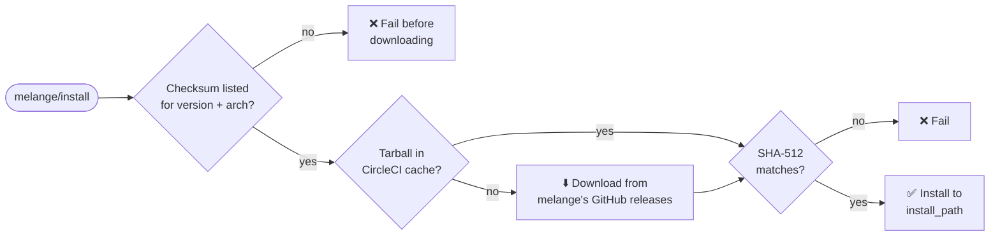

<div align="center">


# Melange Orb for CircleCI

**Build signed APK packages for your distroless images, right inside your CircleCI pipeline.**

<sub>One step to a checksum-verified melange on amd64 and arm64 · No sudo · No telemetry</sub>

<br />

[](https://circleci.com/gh/juburr/melange-orb)
[](https://circleci.com/developer/orbs/orb/juburr/melange-orb)
[](LICENSE)
[](#-supported-platforms)
[](#-checksum-verification)
[](https://discuss.circleci.com/c/ecosystem/orbs)

[Quick Start](#-quick-start) •
[Parameters](#-parameters) •
[Checksums](#-checksum-verification) •
[Building Packages](#-building-packages) •
[Security](#-security) •
[Contributing](#-contributing)

</div>

<br />

[melange](https://github.com/chainguard-dev/melange) builds APK packages from declarative YAML pipelines, and pairs with [apko](https://github.com/chainguard-dev/apko) to assemble minimal, distroless container images. This orb installs melange in your CircleCI jobs: verified against a SHA-512 checksum pinned in the orb, cached between runs, and with no `sudo` anywhere. You get straight to building packages.

> [!NOTE]
> This is an unofficial melange orb. Contributions are welcome!

## ✨ Why Melange Orb?

<table>
  <tr>
    <td width="50%" valign="top">
      <strong>🔐 Verified, fail-closed installs</strong><br />
      Every binary is checked against a SHA-512 checksum pinned in this orb. A version without a known checksum fails before anything is downloaded.
    </td>
    <td width="50%" valign="top">
      <strong>🙅 No sudo required</strong><br />
      melange installs to a user-owned directory. Nothing in this orb runs as root.
    </td>
  </tr>
  <tr>
    <td width="50%" valign="top">
      <strong>⚡ Cached between runs</strong><br />
      The release tarball is cached per version and architecture, so repeat jobs skip the download. Cached copies are verified too.
    </td>
    <td width="50%" valign="top">
      <strong>🖥️ amd64 and arm64</strong><br />
      The matching Linux build is picked automatically, including on CircleCI's <code>arm.medium</code> machines.
    </td>
  </tr>
  <tr>
    <td width="50%" valign="top">
      <strong>🔗 Straight from the source</strong><br />
      Downloads come only from melange's official GitHub releases. No mirrors, proxies, or third-party domains.
    </td>
    <td width="50%" valign="top">
      <strong>🚫 Zero telemetry</strong><br />
      No usage data of any kind is collected or sent back to the orb developer.
    </td>
  </tr>
  <tr>
    <td width="50%" valign="top">
      <strong>📌 200+ releases covered</strong><br />
      Checksums for every melange release from <code>0.1.0</code> up to the orb's pinned default, on both architectures. Pick yours with <code>version</code>.
    </td>
    <td width="50%" valign="top">
      <strong>🧪 Tested end to end</strong><br />
      Every change builds and verifies a signed APK on amd64 and arm64, with both the <code>docker</code> and <code>bubblewrap</code> runners.
    </td>
  </tr>
</table>

## 🚀 Quick Start

Add the orb, call `melange/install`, then use the `melange` CLI directly in later steps. This orb only installs melange, so every `melange` flag is yours to use.

```yaml
version: 2.1

orbs:
  melange: juburr/melange-orb@0.2

jobs:
  build-apks:
    machine:
      image: ubuntu-2404:current
    resource_class: arm.medium # or medium for amd64
    steps:
      - checkout
      - melange/install
      - run:
          name: Generate Signing Key
          command: melange keygen # writes melange.rsa and melange.rsa.pub
      - run:
          name: Build APKs
          command: |
            melange build melange.yaml \
              --runner docker \
              --arch "$(uname -m)" \
              --signing-key melange.rsa \
              --source-dir dist \
              --out-dir packages

workflows:
  build:
    jobs:
      - build-apks
```

That's it. `packages/<arch>/` now holds your signed APKs and a signed `APKINDEX.tar.gz`, ready for apko. See [Building Packages](#-building-packages) for what each flag does and how to pick a runner.

## 🧰 Parameters

The `install` command accepts the following parameters. `version` and `install_path` can reference environment variables.

| Parameter | Type | Default | Description |
|---|---|---|---|
| `version` | string | Pinned by each orb release | The melange release to install, without the leading `v` (for example, `0.61.2`). |
| `verify_checksums` | enum | `strict` | `strict`, `known_versions`, or `false`. See [Checksum Verification](#-checksum-verification). |
| `install_path` | string | `/home/circleci/bin` | Directory to install the `melange` binary into (no trailing slash). It must already exist. The default exists and is on `PATH` on CircleCI's `cimg` images and Ubuntu machine images. |
| `caching` | boolean | `true` | Cache the downloaded release tarball, keyed by melange version and machine architecture. |

## 🔐 Checksum Verification

The `install` command checks the SHA-512 checksum of the downloaded `melange` binary against a table of checksums maintained in this orb ([`src/scripts/install.sh`](src/scripts/install.sh)). With the default `verify_checksums: strict`, an install goes like this:



The `verify_checksums` parameter controls what happens:

| `verify_checksums` | Version listed in this orb | Version not listed in this orb |
|---|---|---|
| `strict` (default) | Verified; the install fails on a mismatch | The install fails before melange is downloaded from GitHub or a cached copy is unpacked |
| `known_versions` | Verified; the install fails on a mismatch | Installed **without** verification (a warning is logged) |
| `false` | Not verified (a warning is logged) | Not verified (a warning is logged) |

> [!IMPORTANT]
> Before v0.2.0 the default was `known_versions`, which installed unlisted versions without verification. Pipelines that pin a `version` this orb does not list now fail until the orb is upgraded.

If you need a melange release that this orb doesn't list yet, upgrade the orb or open a PR that adds its checksum (see [Contributing](#-contributing)). To accept an unverified binary in the meantime, opt out explicitly:

```yaml
steps:
  - melange/install:
      version: "0.62.0"
      verify_checksums: known_versions
```

## 💻 Supported Platforms

The `install` command detects the machine architecture with `uname -m` and installs the matching Linux build of melange:

| `uname -m` | Release asset installed |
|---|---|
| `x86_64` | `melange_<version>_linux_amd64.tar.gz` |
| `aarch64` or `arm64` | `melange_<version>_linux_arm64.tar.gz` |

Any other architecture, or an operating system other than Linux, fails the install. Checksums are recorded per version and architecture, so `strict` verification covers both amd64 and arm64 (for example, CircleCI's `arm.medium` resource class). The cache key also includes the architecture, so amd64 and arm64 jobs in the same project never restore each other's downloads.

## 📦 Building Packages

The [Quick Start](#-quick-start) job is the same flow this orb's own CI runs on every change, on amd64 and arm64 machine executors (see `build-smoke-test` in [`.circleci/test-deploy.yml`](.circleci/test-deploy.yml)). It generates a signing key, then builds a package that copies a prebuilt binary into a signed APK for the machine's own architecture.

- `--arch "$(uname -m)"` builds only for the machine's own architecture. Without it, melange builds every architecture the package supports, and building for foreign architectures needs emulation.
- Packages are written to `packages/<arch>/` (`x86_64` or `aarch64`) along with an `APKINDEX.tar.gz` signed by `melange.rsa`. apko can then use the directory as a local repository, with `melange.rsa.pub` as the trusted key.
- A key generated per job is fine when apko consumes the packages in the same pipeline. Keep a persistent key if you publish the packages.

### Choosing a Runner

`melange build` runs each package's pipeline in an isolated build environment created by a *runner*. Results on CircleCI's `ubuntu-2404:current` machine images (amd64 `medium` and arm64 `arm.medium`):

| Runner | Result | Setup |
|---|---|---|
| `docker` (recommended) | ✅ Works on amd64 and arm64 | None. The `circleci` user can already use the machine's Docker daemon. No images are pulled; melange builds the build environment locally. |
| `bubblewrap` (melange's default on Linux) | ⚠️ Works on amd64 and arm64 after setup | Requires `sudo`: install `bubblewrap`, and allow it to create user namespaces. Without the second step it fails with `bwrap: setting up uid map: Permission denied`, because Ubuntu 24.04's AppArmor restricts unprivileged user namespaces (`kernel.apparmor_restrict_unprivileged_userns = 1`). See [`tests/smoke/setup_bubblewrap.sh`](tests/smoke/setup_bubblewrap.sh). |
| `qemu` | ❌ Not usable | Needs `/dev/kvm`, which machine executors don't provide. |

Pass `--runner` explicitly. If it is omitted on Linux, melange tries `bubblewrap` and fails unless the setup above has been done.

The Docker executor is not covered by these tests and isn't recommended for `melange build`. The `docker` runner needs a local Docker daemon: `setup_remote_docker` runs the daemon on a separate host that can't mount the job's files. The `bubblewrap` runner needs to create user namespaces inside the job's container.

## 🔒 Security

This orb is secure by design:

- **Least Privilege**: Installs to a user-owned directory by default, with no `sudo` usage anywhere in this orb.
- **Integrity**: Checksum validation of all downloaded binaries using SHA-512. Installs fail closed by default when no checksum is known for the requested version (see [Checksum Verification](#-checksum-verification)).
- **Provenance**: Installs directly from melange's official [releases page](https://github.com/chainguard-dev/melange/releases/) on GitHub. No third-party websites, domains, or proxies are used.
- **Confidentiality**: All secrets and environment variables are handled in accordance with CircleCI's [security recommendations](https://circleci.com/docs/security-recommendations/) and [best practices](https://circleci.com/docs/orbs-best-practices/).
- **Privacy**: No usage data of any kind is collected or shipped back to the orb developer.

### Network Access for Security Teams

Required external access to allow, if running a locked down, self-hosted CircleCI pipeline on-prem:

- `github.com`: For download and installation of the melange tool.
- `release-assets.githubusercontent.com` and `objects.githubusercontent.com`: GitHub redirects release downloads from `github.com` to one of these hosts, so the download fails if they are blocked. Allow both; GitHub currently uses `release-assets.githubusercontent.com` and previously used `objects.githubusercontent.com`.

Additional access needed by `melange build` itself (not by this orb's `install` command) when building against the [Wolfi](https://wolfi.dev) package repository:

- `packages.wolfi.dev`: Serves the repository's signing key (`/os/wolfi-signing.rsa.pub`), package index, and the packages that make up the build environment, such as `busybox`.
- Builds that list other repositories or keyrings in `environment.contents`, fetch sources (`fetch`, `git-checkout`), or download anything from pipeline steps (for example `go mod download`, `npm install`, or `pip install` with a cold cache) also need the hosts those steps contact.

## 🤝 Contributing

Issues and pull requests are welcome. The most common contribution is adding the checksums for a new melange release:

```bash
# Downloads the amd64 and arm64 tarballs, checks them against melange's
# published SHA-256 checksums, and prints one lookup table entry per architecture.
src/scripts/install_hash.sh -v 0.62.0
```

Add the printed entries to the `sha512sums` table in [`src/scripts/install.sh`](src/scripts/install.sh), then run the hermetic install script tests. They stub out the network, so they run anywhere:

```bash
bash tests/install_test.sh
```

CI lints and packs the orb, runs ShellCheck, and runs the install and build smoke tests on amd64 and arm64 before any release is published.

## 🎨 Logo

Using the logo in a talk, blog post, or internal docs? Grab it from [`assets/logos`](assets/logos) in
[64](assets/logos/melange-orb-64px.png),
[128](assets/logos/melange-orb-128px.png),
[256](assets/logos/melange-orb-256px.png),
[512](assets/logos/melange-orb-512px.png), or
[1024](assets/logos/melange-orb-1024px.png) px.

## 📜 License

Released under the [MIT License](LICENSE).

<br />

<div align="center">
  
  <br />
  <sub>If this orb saves you time, consider giving it a ⭐ on GitHub.</sub>
</div>
